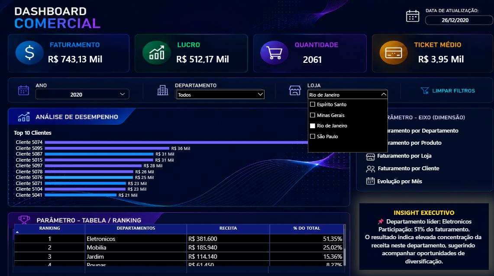
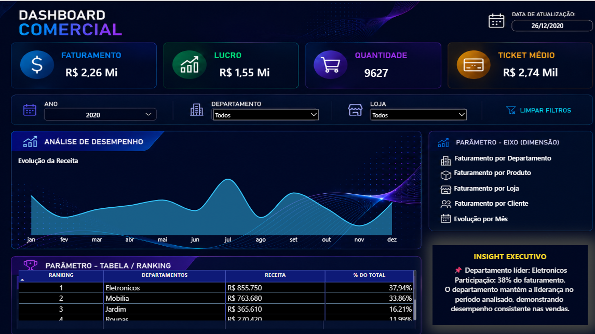
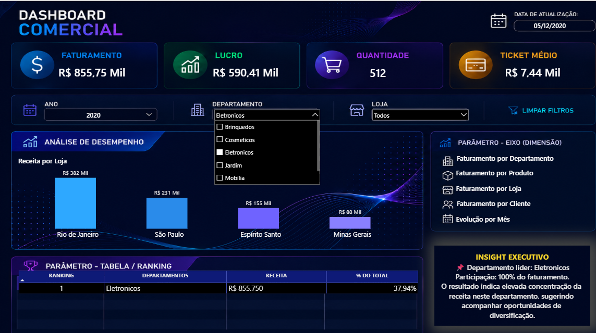
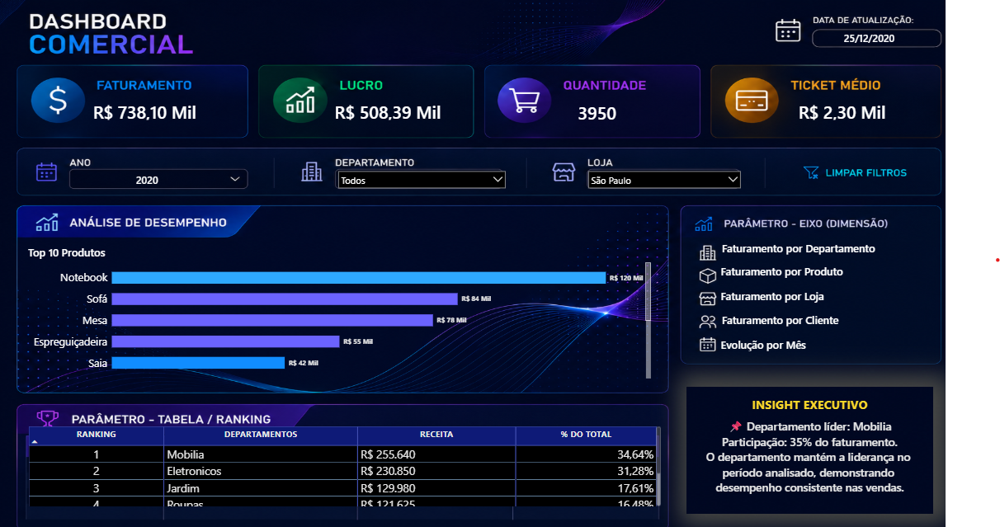

# 📊 Dashboard Comercial | Power BI

## 📌 Sobre o Projeto

Este projeto foi desenvolvido para demonstrar um fluxo completo de Business Intelligence, desde a modelagem da base de dados até a construção de um dashboard executivo interativo.

O objetivo é transformar dados comerciais em informações estratégicas que apoiem a tomada de decisão.

---

## 🚀 Tecnologias utilizadas

- SQL Server
- SQL
- Power Query
- Modelagem Dimensional (Star Schema)
- DAX
- Power BI

---

## 📈 Principais indicadores

✔ Receita

✔ Lucro

✔ Quantidade Vendida

✔ Ticket Médio

✔ Ranking de Departamentos

✔ Receita por Loja

✔ Receita por Produto

✔ Receita por Cliente

✔ Evolução da Receita

✔ Insight Executivo Dinâmico

---


## 🗄️ Exemplos de SQL

### Criação do banco de dados

```sql
CREATE DATABASE DashboardComercial;
GO

USE DashboardComercial;
GO
```

### Importação de dados com BULK INSERT

Exemplo de comando utilizado como referência para importar dados de um arquivo CSV para a tabela Departamento.

```sql
BULK INSERT Departamento
FROM 'C:\Projeto\BDA\Base\Departamento.csv'
WITH (
    FIRSTROW = 2,
    FIELDTERMINATOR = ';'
);
```

### Análise de lojas por cidade

Consulta que agrupa as lojas por cidade e contabiliza quantas lojas existem em cada grupo.

```sql
SELECT
    Cidade,
    COUNT(*) AS TotalLojas
FROM Lojas
GROUP BY Cidade;
```

### Validação dos dados importados

Consultas utilizadas para visualizar os primeiros cinco registros das tabelas.

```sql
SELECT TOP 5 * FROM Clientes;
SELECT TOP 5 * FROM Produtos;
SELECT TOP 5 * FROM Departamento;
SELECT TOP 5 * FROM Lojas;
SELECT TOP 5 * FROM NotasFiscais;
```


## 🧮 Exemplos de DAX

### Faturamento

Calcula o faturamento total considerando o preço do produto e a quantidade vendida.

```dax
Faturamento =
SUMX(
    fNotasFiscais,
    RELATED(dProdutos[VL_Produto]) * fNotasFiscais[Quantidade]
)
```

### Lucro

Calcula a diferença entre o faturamento e o custo total.

```dax
Lucro =
[Faturamento] - [Custo Total]
```

### Ticket Médio

Calcula o faturamento dividido pela quantidade de notas fiscais distintas.

```dax
Ticket Médio =
DIVIDE(
    [Faturamento],
    DISTINCTCOUNT(fNotasFiscais[Cod_NFiscal])
)
```

### Margem %

Calcula a relação entre o lucro e o faturamento.

```dax
Margem % =
DIVIDE(
    [Lucro],
    [Faturamento]
)
```

## 📷 Dashboard

### Visão de Clientes


### Evolução da Receita


### Desempenho por Loja


### Análise de Produtos


### Receita por Departamento


## 💡 Análises e valor para o negócio

Este projeto reúne diferentes visões dos dados comerciais para facilitar o acompanhamento dos resultados e apoiar a tomada de decisão.

- **Clientes:** identificar os clientes com maior contribuição para o faturamento.
- **Evolução da receita:** acompanhar o comportamento das vendas ao longo do tempo.
- **Lojas:** comparar o desempenho comercial entre unidades.
- **Produtos:** analisar os produtos com maior participação nas vendas.
- **Departamentos:** visualizar a contribuição de cada departamento para a receita.

A proposta é transformar dados em informações mais claras, facilitando a identificação de tendências, oportunidades e pontos que merecem atenção.

## 📚 Aprendizados

Durante o desenvolvimento, trabalhei com consultas SQL, transformação de dados, modelagem dimensional, medidas DAX e construção de visualizações no Power BI.
